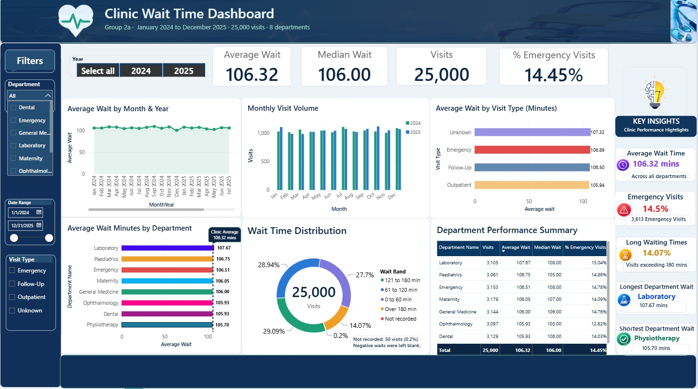

# Clinic Wait-Time Analysis

**Group 2a · Clinic visits · Data Science & Analytics Internship (8-week project)**

## Summary

**Question:** Which departments have the longest patient wait times, and how does that vary by visit type and over time?

**Answer:** Patients wait about 106 minutes on average, in every department, every visit type and every month. No department stands out. The decision for the clinic administrator is to treat waiting as a clinic-wide process issue, not to single out one department.

## Introduction

A clinic with eight departments is experiencing patient complaints about waiting times. While staff members have differing opinions about which departments experience the longest delays, no systematic analysis of the clinic's visit records has been conducted to establish what is actually happening.

This project addresses that gap through a data-driven investigation of patient waiting times, with the clinic administrator as the primary audience. Since the intended user is not a data analyst, our objective extends beyond analysing data: we aim to translate complex information into clear, accessible and actionable insights that can support informed operational decisions without requiring an analyst to interpret the dashboard.

Undertaken as part of an eight-week Data Science and Analytics internship, the project involves two groups independently investigating the same business question using the same dataset, allowing their analytical approaches and solutions to be compared.

Our analysis began with 25,100 raw patient visit records covering January 2024 to December 2025. We progressed through data exploration and quality assessment, data cleaning and preparation, dimensional modelling using a star schema in Power BI and the development of an interactive, one-page dashboard.

The project follows a structured analytical journey, moving from understanding the business problem to preparing reliable data, building an analytical model, designing and refining the dashboard and ultimately communicating evidence-based findings and recommendations.

Our ultimate goal is simple: transform clinic data into insights that help management understand waiting-time patterns and make better-informed decisions.


## Findings

- **Departments:** all eight sit within 2.0 minutes of each other, from 105.7 (Physiotherapy) to 107.7 (Laboratory). The clinic average is 106.32 minutes and the median is 106.00.
- **Visit type:** Emergency visits wait 106.9 minutes, about the same as Outpatient (105.9) and Follow-up (106.5). Emergency patients do not wait less than routine ones.
- **Over time:** monthly averages stay between 100.6 and 109.8 minutes across 2024 and 2025, with no upward or downward trend.
- **Spread:** individual waits vary widely. About 14% of visits waited more than 3 hours, and about 28% waited an hour or less.
- **Emergency share:** 14.45% of visits (3,613 of 25,000).

**Recommendations:** Review scheduling and patient flow in every department, report the share of visits over 3 hours each month and record visit type on every visit so that no waits are missing or impossible.

## Approach

1. **Scope (week 1).** We turned the question into sub-questions and agreed what was out of scope. See `scope.md`.
2. **Profile the data in SQL (week 2).** We found six planted problems, with numbers. See `data_quality_notes.md` and the queries in `sql/`.
3. **Clean it in Python (week 3).** We fixed each problem, recorded the reason, and accounted for every row: 25,100 raw visits minus 100 duplicates is 25,000 clean visits. See `notebooks/`.
4. **Build the model (week 4).** A star schema in Power BI with a date table we built ourselves.
5. **Measures and dashboard (weeks 5 and 6).** Five measures, each checked against SQL and one dashboard page.
6. **Present (weeks 7 and 8).** See `presentation/`.

## The data

| Table | Rows | Contents |
|---|---|---|
| `visits` | 25,100 | Fact table — one row per visit: date, patient, doctor, department, visit type, wait minutes, fee |
| `patients` | 900 | Birth year, sex, region, insurance scheme |
| `doctors` | 40 | Name, department, years of experience |
| `departments` | 8 | Department name, floor |

Source: The data is in PostgreSQL. We read from the read-only `raw_clinic` schema and wrote our cleaned tables to our own `group2a` schema: `visits_clean` (25,000 rows), `patients_clean` (901 rows: 900 patients plus an "Unknown" record), `doctors_clean` (40) and `departments_clean` (8).

## Data problems and how we handled them
These are catalogued in `data_quality_notes.md`.

| Problem | What we found | What we did, and why |
|---|---|---|
| Duplicate rows | 100 exact duplicate visits | Kept the first copy. Duplicates would double-count visits. |
| Inconsistent categories | 12 spellings of 3 visit types | Trimmed spaces and standardised case, so each category is one bar. |
| Missing values | 1,508 visits with no visit type | Labelled "Unknown" and kept the rows, because their waits are valid. |
| Date formats | 4 formats stored as text | Parsed into real dates, day first. Proven with dates such as 29/07/2024; 535 rows (2.1%) would change if wrong. |
| Impossible values | 51 negative waits (-209 to 209) | Set to blank and kept the rest of each row. No pattern across departments or months, so any correction would be invented. |
| Orphan keys | 62 visits with no matching patient | Pointed at an "Unknown" patient so every visit stays in the totals. |

## Data model

`visits_clean` is the fact table, where one row is one patient visit. It connects one-to-many, with a single filter direction, to `departments_clean`, `patients_clean` and `DateTable`, a calendar we built (731 days) and marked as a date table. `doctors_clean` connects through `departments_clean`; the direct link to the fact table is left inactive because Power BI blocked a second active path. The date relationship runs on a clean `Visit Day` column. Keys are hidden and columns have plain-English names.

## Measures, checked against SQL

| Measure | Power BI | SQL |
|---|---|---|
| Average Wait | 106.32 | 106.32 |
| Median Wait | 106.00 | 106.0 |
| Visits | 25,000 | 25,000 |
| % Emergency Visits | 14.45% | 14.45% |
| Fee Revenue | 755,945 | 755,945 |

Total wait time (2,652,563) and all eight department totals also matched SQL.

## Dashboard

One page, built for the clinic administrator: four headline cards, charts by department, visit type and month, monthly visit volume, the spread of waits, a department summary table, a key insights panel, and slicers for year, department, date range and visit type. Every chart axis starts at zero so small gaps are not exaggerated.




## Repository structure

```
Data-Science-Internship-Group-2a-Clinic-Visits/
  README.md                 this file
  scope.md                  week 1: question and scope
  breakout-week1.md         week 1: breakout session notes
  data_quality_notes.md     week 2: what we found wrong with the data
  sql/                      our queries (profiling and checks)
  notebooks/                the cleaning notebook
  dashboard/                the Power BI file (.pbix)
  presentation/             the final slides
```


## How to rebuild this

1. **Database access:** connect to the PostgreSQL instance at `internship-db.coh86gwewtxb.us-east-1.rds.amazonaws.com:5432`, database `internship`, using the `group2a` credentials (password held by the group lead). SSL required. Read from `raw_clinic`, write to `group2a`.
2. **Run the queries.** The files in `sql/` run in any PostgreSQL client (we used DBeaver). They read from `raw_clinic`.
3. **Run the cleaning notebook** in `notebooks/` from top to bottom, in Google Colab or any Jupyter environment. It needs Python 3 with pandas, numpy, SQLAlchemy and psycopg2. It asks for the password at run time, reads from `raw_clinic`, and writes the four clean tables to `group2a`. Only one person should run the final write-back, because it replaces the shared tables.
4. **Open the dashboard.** Open the `.pbix` in `dashboard/` with Power BI Desktop (Windows). It reads the four `_clean` tables from `group2a`, not from exported files.
5. **Check any figure.** Re-run the measure checks in `sql/` and compare them with the dashboard.


## Limitations

- The data shows where waits happen, not why. Explaining why would need arrival, triage and seen times and staffing data.
- We did not run a statistical test, so we describe the departments as not meaningfully different instead of ranking them.
- 1,500 visits have no visit type, which limits the visit-type comparison. Averages exclude 50 blanked waits (24,950 timed visits).
- We did not test whether busier months have longer waits, or whether the department ranking is stable month to month.

## Project timeline

| Week | Phase | Deliverable |
|---|---|---|
| 1 | Scope | `scope.md`, breakout notes |
| 2 | Profile the data (SQL) | `data_quality_notes.md` |
| 3 | Clean the data (Python) | Cleaning notebook + cleaned tables in `group2a` |
| 4 | Build the model (Power BI) | Star schema, relationships set, no visuals yet |
| 5 | Measures & first dashboard draft | Rough dashboard, measures working |
| 6 | Iterate | Revised dashboard |
| 7 | Freeze & rehearse | Documentation complete, presentation rehearsed (scope frozen) |
| 8 | Submit & present | Final dashboard, repo, ten-minute demo |

## Notes

- This dataset is shared with group2b, who are answering the same question independently. Data quality findings are shared openly between the groups. Our analysis and decisions are our own.
- No passwords and no data files are committed to this repository.
