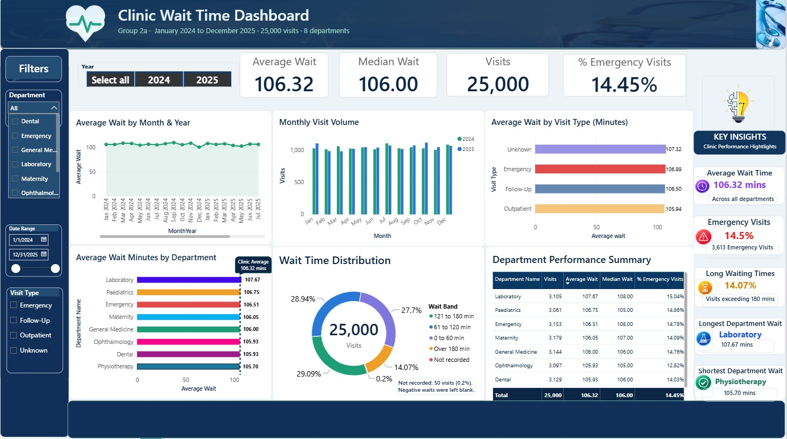

**Week 5 — Measures and first dashboard**

**Group 2a**  ·  Clinic visits  ·  your week 5 deliverable

| Group | group2a |
| :---- | :---- |
| **Phase lead this week** | Regina Robertson |
| **Who wrote the measures** | Regina Robertson |
| **Who built the dashboard** | Regina Robertson |
| **Date completed** | 28th October, 2026 |

| Your question Which departments have the longest patient wait times, and how does that vary by visit type and over time? |
| :---- |

**Ugly is expected this week**

You are proving the numbers are right, not designing anything. Week 6 is when it gets to look good. A beautiful dashboard built on a wrong total is worse than an ugly one built on a right total, because nobody questions it.

**1\. Your measures**

Five is plenty. Write the DAX for each one here — we will be reading it, so format it readably.

**1\.  Average Wait**

| The DAX: Average Wait = AVERAGE('group2a visits_clean'[Wait Time (Minutes)]) |
| :---- |

**2\.  Median Wait**

| The DAX: Median Wait = MEDIAN('group2a visits_clean'[Wait Time (Minutes)]) |
| :---- |

**3\.  Visits**

| The DAX: Visits = COUNTROWS('group2a visits_clean') |
| :---- |

**4\.  % Emergency Visits**

| The DAX: % Emergency Visits =
DIVIDE(
    CALCULATE(
        COUNTROWS('group2a visits_clean'),
        'group2a visits_clean'[Visit Type] = "Emergency"
    ),
    COUNTROWS('group2a visits_clean')
) |           
| :---- |

**5\.  Fee Revenue**

| The DAX: Fee Revenue = SUM('group2a visits_clean'[Consultation Fee]) |
| :---- |

`Clinic Average Wait` drives the dashed reference line on the department chart. `Visits Display` is a text version of Visits, used only so a card reads 25,000 instead of 25K. We also added a `Wait Band` column (0 to 60, 61 to 120, 121 to 180, over 180 minutes) for the distribution chart, `MonthYear` and `MonthShort` columns on the date table (sorted by number so months stay in order) and a clean `Visit Day` date column on the fact table.

**2\. Proving the numbers are right**

Every measure, checked against a SQL query in DBeaver. This is the most important section in the form — a measure that returns a plausible wrong number is worse than one that errors, because nobody notices.

| \-- the pattern, in DBeaver SELECT round(sum(wait\_minutes), 2\) FROM group2a.visits\_clean; \-- then drop the measure into a card in Power BI \-- the two must match exactly |
| :---- |

```sql
SELECT round(avg(wait_minutes)::numeric, 2) AS average_wait FROM group2a.visits_clean;
SELECT percentile_cont(0.5) WITHIN GROUP (ORDER BY wait_minutes) AS median_wait FROM group2a.visits_clean;
SELECT count(*) AS visits FROM group2a.visits_clean;
SELECT round(100.0 * count(*) FILTER (WHERE visit_type = 'Emergency') / count(*), 2) AS pct_emergency FROM group2a.visits_clean;
SELECT round(sum(consultation_fee)::numeric, 2) AS fee_revenue FROM group2a.visits_clean;
```

| Measure name | Power BI says | SQL says | Match? If not, why |
| :---- | :---- | :---- | :---- |
| **Average Wait** | 106.32 | 106.32 | Yes |
| **Median Wait** | 106.00 | 106.0 | Yes |
| **Visits** | 25,000 | 25,000 | Yes |
| **% Emergency Visits** | 14.45% | 14.45% | Yes, once formatted as a percentage (see below) |
| **Fee Revenue** | 755,945.00 | 755,945.00 | Yes |

We also checked the total wait time (2,652,563 in both Power BI and SQL) and the eight department totals, which matched row for row and added up to the same grand total.

| If any did not match — what was wrong, and what did you change? |
| :---- |

Four matched straight away. The % Emergency Visits card first read 0.14 against 14.45 in SQL. The measure was correct, but it was formatted as a decimal, so we changed its format to percentage and it showed 14.45%.

We also found two problems in the model, not in the measures:

- **The Year slicer returned blank** and 2024 and 2025 showed no data. The calendar table was not matching `Visit Date`, most likely because of a hidden time part. We added a clean `Visit Day` column, re-linked the calendar to it and hid `Visit Date`. Year and Visits then added up to 25,000.

- **The cards once showed 106.75, 105.00 and 3K,** because a Paediatrics bar was selected and was filtering the whole page. Clearing the selection restored 106.32, 106.00 and 25,000.


**3\. Assumptions you had to make**

Some measures need a decision that the data cannot settle, exactly like dayfirst in week 3\. State them plainly — you will be asked to defend them in week 8\.

**Do you report mean or median wait as the headline — and why?**

| Our decision, and why: We showed both side by side. The average (106.32 minutes) is the figure we quoted, with the median (106.00) next to it as a check. They differ by only 0.32 minutes, so the choice does not change any conclusion. The median is the safer of the two if extreme values matter and our data had impossible values (waits as low as -209) that we blanked.|
| :---- |

**Any other assumptions buried in your measures:**

- Average and median ignore the 50 negative waits we set to blank in week 3, so they are based on 24,950 timed visits not 25,000.
- % Emergency Visits divides by all 25,000 visits, including the 1,500 with an Unknown visit type. If Unknown were excluded, the share would be 3,613 of 23,500, about 15.4%.
- Visits with an Unknown visit type are kept as their own category and are not excluded from any measure.
- The clinic average line follows the Year and Visit Type slicers but ignores the department filter, so it always compares a department with the clinic as a whole.
- Fee Revenue sums consultation fees exactly as recorded. We did not investigate zero fees, because fees are outside our question.
- The wait bands use cut-offs at 60, 120 and 180 minutes, which is our own choice.
- Dates are read day first (DD/MM/YYYY), the week 3 decision.

**4\. Your dashboard page**

One page. Cards along the top, a trend, a breakdown, at least one slicer.

| Which measures are on the cards? Average Wait, Median Wait, Visits and % Emergency Visits. Fee Revenue is built and checked, but it is not on the page because it does not help answer the question.|
| :---- |
| **What is the trend chart showing, and is it using dim\_date rather than the fact table's own date column?** Average Wait by Month & Year shows the average wait for each month from January 2024 to December 2025. Its axis is `MonthYear` from our own date table (`DateTable`), not a date column from the fact table. A second chart, "Monthly Visit Volume", shows visits per month with 2024 and 2025 side by side, using `MonthShort` and `Year` from the same date table. |

| **What is the breakdown chart showing?** Average wait by department (a bar chart with a dashed clinic average line), average wait by visit type, a doughnut of the spread of waits by wait band and a department performance summary table with visits, average, median and % emergency. |

| **Which slicers did you add? Did you click them and watch every visual change?** Year, Visit Type, Department and a date range. We tested them by clicking: choosing 2024 changed the cards (12,449 visits, average 106.41), ticking Emergency showed 3,613 visits and clicking a department bar filtered the page. The cards, charts and table all responded. The slicers also exposed the blank Year problem described above. |

**Paste a screenshot of the page below**



| :---- |

**5\. What does it actually say?**

You now have real numbers for the first time. What do they tell you about your question?

| The single most interesting thing you can see so far:  |
| :---- |
| **Anything that surprised you, or contradicted what you expected in week 1:**  |
| **Anything that looks wrong rather than surprising — and what you plan to check:**  |

**6\. Ready for week 6?**

Week 6 is iteration — fixing what this draft exposed and making it readable. Think about what it exposed.

| What is missing from the model that you now wish you had? (A dimension, a column, a derived field.)  |
| :---- |
| **Which of your week 1 sub-questions can this dashboard already answer?**  |
| **Which cannot be answered yet, and what would it take?**  |

**7\. Questions for the weekly call**

|   |
| :---- |

| Before you submit this Five measures written, named in plain English and formatted. Every one checked against SQL. One dashboard page with cards, a trend, a breakdown and a working slicer. The .pbix committed to dashboard/. Measure definitions can be discussed openly with group2b. Your dashboard and your findings stay yours. |
| :---- |

